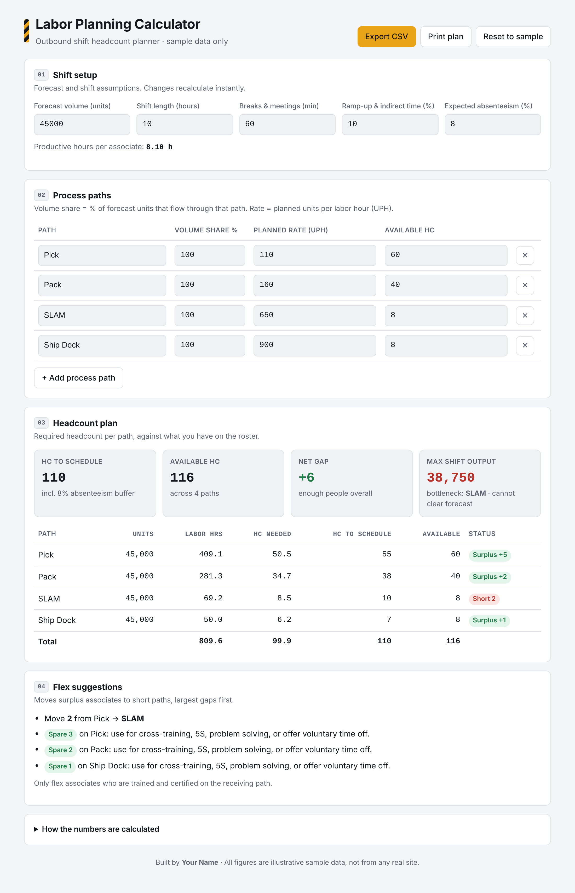

# Labor Planning Calculator

A lightweight web tool that turns a shift's **volume forecast** and **planned rates** into the **headcount needed per process path**, then shows where the building is short, where it is overstaffed, and which path will limit output.

**Live demo:** https://ShadLabs.github.io/labor-planning-calculator/



**Available in English and Arabic.** Switch with the button at the top, or open the Arabic version directly: `https://ShadLabs.github.io/labor-planning-calculator/?lang=ar`


## The problem

In outbound fulfillment, labor is usually set at the start of the shift from a forecast. When the plan is done by gut feel, one path ends up overstaffed while another becomes the bottleneck. CPTs are put at risk, and people are moved around reactively mid-shift.

I worked for almost two years as a Pack and Outbound Process Assistant. I built this tool to make the start-of-shift labor plan quick, consistent, and easy to explain to a manager.

## What it does

- Calculates **productive hours per associate** after breaks, meetings, and ramp-up/indirect time
- Converts forecast units into **labor hours and headcount** for each process path (Pick, Pack, SLAM, Ship Dock, or any paths you add)
- Adds an **absenteeism buffer** so you schedule enough people for who actually shows up
- Flags each path as **Short**, **Balanced**, **Surplus**, or **Overstaffed**
- Identifies the **bottleneck path** and the **maximum units** the shift can ship with the current roster
- Suggests **flex moves** from surplus paths to short paths, and what to do with any leftover gap
- Works in **English and Arabic**, with a full right-to-left layout in Arabic
- Lets you **export to CSV** (opens correctly in Excel in both languages) and **print** the plan
- Saves your inputs in the browser automatically

## How it calculates

| Step | Formula |
|---|---|
| Productive hours | (shift length − breaks) × (1 − indirect %) |
| Units per path | forecast × volume share % |
| Labor hours | units ÷ planned rate (UPH) |
| HC needed | labor hours ÷ productive hours |
| HC to schedule | HC needed ÷ (1 − absenteeism %), rounded up |
| Gap | available HC − HC to schedule |
| Max output (bottleneck) | available HC × show-up rate × productive hours × rate ÷ volume share |

## Tech

Plain HTML, CSS, and JavaScript. No frameworks and no build step, hosted free on GitHub Pages.

## Project structure

```
labor-planning-calculator/
├── index.html          # page layout
├── css/
│   └── style.css       # styling, light and dark mode, print layout
├── js/
│   ├── app.js          # calculations, flex logic, CSV export, saved inputs
│   └── i18n.js         # English and Arabic text
├── docs/
│   ├── screenshot.png     # English screenshot
│   └── screenshot-ar.png  # Arabic screenshot
├── LICENSE
└── README.md
```

## Run it

- **Online:** open the live demo link above.
- **Locally:** download or clone the repo and open `index.html` in any browser.

## Data note

All rates, volumes, and headcounts are **illustrative sample data**. They are not taken from any real site or employer system.

## Ideas for next version

- Hourly plan with a break schedule per wave
- Compare plan vs. actual at end of shift

---
Built by **Shadrack Kpani Odametey** · [LinkedIn](https://www.linkedin.com/in/Shadrack-Odametey)
